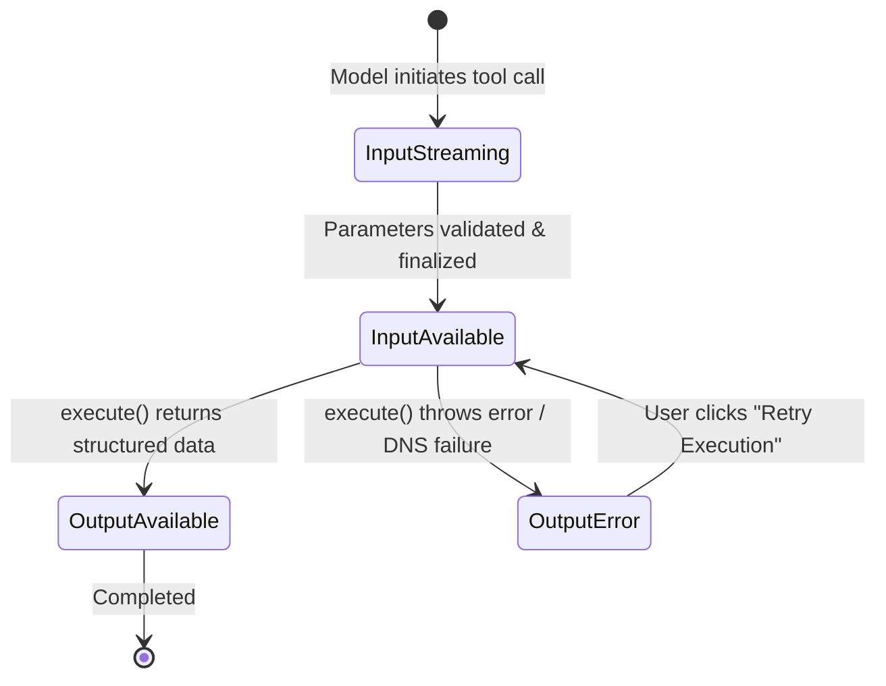

# FlyRank Generative UI Studio — Tool Results & Structured Output

[](.)
[](.)
[-black.svg)](https://nextjs.org/)
[](https://ai-sdk.dev/)
[](https://pnpm.io/)
[](https://tailwindcss.com/)

> **Tool Results and Structured Output in the UI (FE-07)**  
> Build Phase · Week 5 · Frontend AI Engineering Track  
> Why it matters: Real AI products call tools and return structured data your UI must render as components. This generative UI skill separates a chat wrapper from an application.

---

## 🚀 Live Preview & Core Deliverables

- **Tool Definition File:** [`src/lib/tools/audit-website.ts`](src/lib/tools/audit-website.ts) & [`src/lib/tools/index.ts`](src/lib/tools/index.ts)
- **AI Route Handler:** [`src/app/api/chat/route.ts`](src/app/api/chat/route.ts)
- **Lifecycle Router:** [`src/components/tools/tool-invocation-renderer.tsx`](src/components/tools/tool-invocation-renderer.tsx)
- **Generative UI Component:** [`src/components/tools/website-audit-card.tsx`](src/components/tools/website-audit-card.tsx)

---

## 🧭 Tool Lifecycle State Machine

As emphasized by mentor guidance, the four tool part states represent a formal state machine answering distinct user questions at every phase:



| Lifecycle State | Question Answered | Visual Treatment | Trigger / AI SDK State |
|---|---|---|---|
| **1. Input Streaming** | *What is the model planning to do?* | Monospace blueprint console with glowing cursor, token-by-token parameter streaming, status badge `Summoning Tool: auditWebsite`. | `partial-call` (`tool_call_streaming_start` + `tool_call_delta`) |
| **2. Input Available** | *What is it executing right now with what validated input?* | Active radar spinner, live duration ticker (`1.2s`), validated argument chips, step checklist (✓ Schema validated, ⟳ Network probe, ⟳ Computing Core Web Vitals). | `call` (`tool_call` finalized) |
| **3. Output Available** | *What findings and metrics came back?* | **Rich Generative UI Component**: Hand-rolled SVG Score Ring (0-100), Core Web Vitals grid (LCP, INP, CLS, TTFB), Crawled Meta Tags drawer, Diagnostic Findings Table with severity tags. | `result` (Success payload) |
| **4. Output Error** | *What went wrong and how does the user recover?* | Designed error card with crimson/amber caution accent, error code (`ERR_DNS_UNREACHABLE`), plain-English root cause, troubleshooting checklist, and interactive **"Retry"** & **"Test flyrank.io"** action buttons. Prevents UI crash! | `result` with `{ isError: true, error: ... }` |

---

## 📜 Tool Contracts & Schemas

### 1. Primary Tool: `auditWebsite`
- **Definition File:** [`src/lib/tools/audit-website.ts`](src/lib/tools/audit-website.ts)
- **Description:** Audits a target web property for Core Web Vitals, technical SEO health, meta tag extraction, and actionable diagnostics.

#### Zod Input Schema:
```typescript
import { z } from 'zod';

export const auditWebsiteInputSchema = z.object({
  url: z
    .string()
    .url()
    .describe('The complete HTTP/HTTPS web address to audit (e.g. "https://flyrank.io")'),
  depth: z
    .enum(['quick', 'comprehensive'])
    .default('quick')
    .describe('Depth of the audit: "quick" (Core Web Vitals + Meta) or "comprehensive" (deep diagnostics + asset crawl)'),
  targetMetric: z
    .enum(['all', 'performance', 'seo', 'accessibility', 'security'])
    .default('all')
    .describe('Specific evaluation category to prioritize'),
  simulateError: z
    .boolean()
    .optional()
    .describe('Intentionally triggers a network or DNS resolution failure to test designed error states'),
});
```

#### Return Shape:
```typescript
export interface WebsiteAuditResult {
  targetUrl: string;
  auditDepth: 'quick' | 'comprehensive';
  targetMetric: string;
  timestamp: string;
  overallScore: number; // 0 - 100
  status: 'passed' | 'warning' | 'critical';
  vitals: {
    lcp: VitalMetric;   // Largest Contentful Paint (< 2.5s)
    inp: VitalMetric;   // Interaction to Next Paint (< 200ms)
    cls: VitalMetric;   // Cumulative Layout Shift (< 0.10)
    ttfb: VitalMetric;  // Time to First Byte (< 800ms)
  };
  meta: {
    title: string;
    description: string;
    canonical: string;
    robots: string;
    ogType?: string;
    ogImage?: string;
  };
  findings: Array<{
    id: string;
    severity: 'critical' | 'warning' | 'info';
    category: 'performance' | 'seo' | 'accessibility' | 'security';
    title: string;
    impact: string;
    recommendation: string;
    estimatedSavings?: string;
  }>;
  summary: {
    criticalCount: number;
    warningCount: number;
    infoCount: number;
    estimatedLcpSavingsMs: number;
  };
}
```

---

### 2. Secondary Tool (Stretch Goal): `scoreLeadPipeline`
- **Definition File:** [`src/lib/tools/score-lead.ts`](src/lib/tools/score-lead.ts)
- **Description:** Qualifies enterprise inbound leads based on traffic volume, team headcount, and budget capacity.
- **Generative UI Component:** [`src/components/tools/lead-score-card.tsx`](src/components/tools/lead-score-card.tsx) (Features SVG Fit Factor Bar Chart & Conversion Probability Gauge).

---

### 3. Action Tool (Stretch Goal): `confirmOptimizationFix`
- **Definition File:** [`src/lib/tools/confirm-fix.ts`](src/lib/tools/confirm-fix.ts)
- **Description:** Human-in-the-loop tool requiring explicit user approval before deploying automated optimization fixes to production assets.

---

## 🎨 Motion with Intent & Design System

1. **Morphing Containers (No Layout Jumps):**
   - Tool parts transition using `@starting-style` and smooth CSS cubic-bezier transforms (`transition: all 0.25s cubic-bezier(0.16, 1, 0.3, 1)`).
   - Rather than abruptly swapping nodes, the card morphs from the drafting blueprint into the active radar console and expands into the generative UI score card with a 200ms crossfade.
2. **Designed Error State First:**
   - Evaluators can trigger the failure mode by typing or clicking the preset: `Audit https://invalid-domain-error.test`.
   - The application never crashes or prints raw JSON; it renders a dedicated `ToolErrorCard` with interactive retry options.
3. **Dual Execution Runtime:**
   - **Live Inference:** If `ANTHROPIC_API_KEY` is set in `.env.local`, calls Claude 3.5 Sonnet with native AI SDK tool execution.
   - **High-Fidelity Simulator:** If no API key is provided, a built-in deterministic simulator streams exact AI SDK v4 Data Stream chunks (`b:`, `c:`, `9:`, `a:`) so reviewers can evaluate all 4 lifecycle states offline with zero configuration.

---

## 💻 Local Development Setup

```bash
# 1. Install dependencies
pnpm install

# 2. Start local development server
pnpm dev

# 3. Open browser at http://localhost:3000
```
